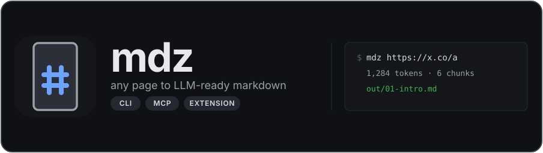

# mdz — any web page to LLM-ready Markdown

<p align="center">
  
</p>

Turn a web page into markdown that an LLM can read. One binary. No account. No API
key. Nothing leaves your machine.

## Quick start

```bash
# one page to markdown on stdout
mdz https://example.com/post

# write it to a file, with a JSON manifest next to it
mdz https://example.com/post --out post.md --json-out post.json

# one .md per section, plus index.json
mdz https://example.com/post --split out

# a whole docs section, two levels deep
mdz https://example.com/docs --crawl 2 --split out
```

`mdz --help` lists every flag. `mdz --version` prints the version.

## Install

Download one file and make it executable. Pick your platform.

```bash
# Linux x64
curl -fsSL https://github.com/pahlevikun/mdz/releases/latest/download/mdz-linux-x64 -o mdz && chmod +x mdz

# macOS, Apple Silicon
curl -fsSL https://github.com/pahlevikun/mdz/releases/latest/download/mdz-darwin-arm64 -o mdz && chmod +x mdz

# macOS, Intel
curl -fsSL https://github.com/pahlevikun/mdz/releases/latest/download/mdz-darwin-x64 -o mdz && chmod +x mdz

# Windows x64
curl -fsSL https://github.com/pahlevikun/mdz/releases/latest/download/mdz-windows-x64.exe -o mdz.exe
```

Then move it onto your `PATH`:

```bash
sudo mv mdz /usr/local/bin/      # Linux and macOS
```

Not on npm. Build from source with `bun run build:cli`.

Verify the install:

```bash
mdz --version
mdz https://example.com | head -20
```

## What you get

```markdown
---
title: Example Domain
url: https://example.com/
domain: example.com
lang: en
words: 25
chars: 156
tokens_o200k: 28
tokens_cl100k: 28
chunks: 1
extractor: defuddle
generator: mdz
---

This domain is for use in documentation examples...
```

- Markdown split by heading. Each section becomes a chunk with a stable id like
  `01-install`.
- Token counts from the real tokenizer, for both `o200k` and `cl100k`. Not
  `length / 4`.
- YAML frontmatter that Obsidian and Logseq read without changes.
- The same extraction in three places: CLI, MCP server, browser extension.

## Use it as an agent tool

`mdz-mcp` speaks MCP over stdio. An agent can read a 40k-token docs page two
sections at a time instead of swallowing it whole.

| Tool | What it does |
|---|---|
| `mdz_outline` | section list, chunk ids and their token cost. Call this first |
| `mdz_read` | one chunk, or the first chunk plus the ids of the rest |
| `mdz_json` | full manifest: outline tree, chunk metadata, markdown |
| `mdz_split` | writes one `.md` per chunk plus `index.json` |
| `mdz_design_tokens` | `DESIGN.md` frontmatter from the page's declared styles |

Client config:

```json
{
  "mcpServers": {
    "mdz": {
      "command": "mdz-mcp"
    }
  }
}
```

### The skill that makes it work

Tools alone do not make an agent read in the right order. `skills/mdz-read/`
does: outline first, then only the chunks the question needs, plus what to do
when a page is blocked or JS-only.

```bash
npx skills add pahlevikun/mdz/skills/mdz-read
```

The repo also ships [`AGENTS.md`](AGENTS.md), which holds the short form of the
same rules for agents that read a repo root instead of installing skills.

Two limits the tools report themselves rather than hiding:

- `mdz` fetches over HTTP and does not run JavaScript. A page that renders its
  body client-side comes back empty, and `tokens: 0` says so.
- `mdz_design_tokens` samples declared CSS, not rendered pixels. A page styled
  only by external stylesheets returns few colors.

## Browser extension

Chrome and Firefox, Manifest V3. Install from the release zip, or load
`apps/extension/build/chrome-mv3-prod` unpacked.

| Shortcut | Action |
|---|---|
| `Alt+Shift+C` | Convert the page |
| `Alt+Shift+S` | Convert the selection |
| `Alt+Shift+M` | Open the preview tab |

The preview tab is an editable markdown pane beside a live render, with a chunk
picker, a token badge, copy, download, and export.

Also in the preview tab:

- **Full page screenshot** — scrolls and stitches the whole page into one PNG.
- **Copy for Figma** — puts HTML, PNG and markdown on the clipboard together.
  Paste into Figma desktop and you get editable frames, not a flat image.
- **Design tokens** — downloads `DESIGN.md` and `tokens.json` built from the
  page's own palette.
- **Stack** — lists frameworks, analytics and hosting found in the page, with
  the evidence for each finding.

Dark and light simulation per tab. Approximate by default, using a CSS filter.
Grant the optional `debugger` permission in settings to get the site's real theme
instead.

### Permissions

`activeTab`, `scripting`, `contextMenus`, `storage`, `clipboardWrite`.

Optional: `debugger`, only if you turn on precise theme emulation.

There is no `host_permissions` and no content script. The extension reads the
active tab when you press a shortcut, and never before.

## Design

The palette, type scale and component rules live in [DESIGN.md](DESIGN.md).
Machine-readable copies are in [`design/`](design/), and
`bun run scripts/check-tokens.ts` fails if the files drift apart.

## Development

```bash
bun install
bun test
bunx tsc -b
bun run build:cli
bun run build:mcp
cd apps/extension && bun run build --target=chrome-mv3
```

Gates that must stay green:

```bash
bun test                        # 119 tests
bunx tsc -b                     # types
bun run scripts/check-tokens.ts # DESIGN.md, tokens.json, tailwind agree
./scripts/check-hygiene.sh      # no other-tool names in the tree
```

## License

MIT. See [LICENSE](LICENSE).
